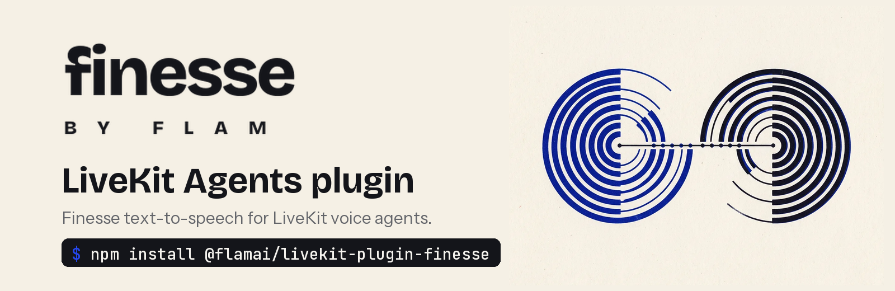

<picture>
  <source media="(prefers-color-scheme: dark)" srcset=".github/assets/banner-livekit-dark.png">
  <source media="(prefers-color-scheme: light)" srcset=".github/assets/banner-livekit-light.png">
  
</picture>

<p>
  <a href="https://www.npmjs.com/package/@flamai/livekit-plugin-finesse"></a>
  
  
  
  <a href="https://github.com/homingos/livekit-finesse/blob/main/LICENSE"></a>
</p>

# Finesse for LiveKit Agents

The [Finesse](https://finesse.flamapp.ai) text-to-speech plugin for
[LiveKit Agents](https://docs.livekit.io/agents/) in Node.js. Give your voice agent a Finesse voice:
one from the catalog, or your own cloned from a few seconds of audio, speaking any of 60 languages,
including 22 Indian languages.

- **Realtime**: the agent's reply streams to Finesse as the LLM writes it, so speech starts before
  the reply is finished.
- **Interruptions handled**: when the user talks over the agent, the reply is cancelled on the
  Finesse server straight away.
- **Telephony ready**: ask for 8 kHz audio for phone calls, or up to 48 kHz for everything else.

**[Finesse docs](https://docs.finesse.flamapp.ai)** ·
**[LiveKit Agents docs](https://docs.livekit.io/agents/)** ·
**[Dashboard](https://finesse.flamapp.ai/dashboard)** ·
**[Changelog](https://github.com/homingos/livekit-finesse/blob/main/CHANGELOG.md)**

> [!NOTE]
> We've also proposed this plugin to LiveKit
> ([livekit/agents-js#2777](https://github.com/livekit/agents-js/pull/2777)). Once it's merged it
> will be available as `@livekit/agents-plugin-finesse` too, with the same options. Until then, use
> this package.

## Contents

- [Installation](#installation)
- [Get an API key](#get-an-api-key)
- [Quickstart](#quickstart)
- [Choose a voice](#choose-a-voice)
- [Languages](#languages)
- [Options](#options)
- [Phone calls](#phone-calls)
- [Changing the voice during a session](#changing-the-voice-during-a-session)
- [Using the TTS on its own](#using-the-tts-on-its-own)
- [Connections and limits](#connections-and-limits)
- [Handling errors](#handling-errors)
- [Requirements](#requirements)
- [Versioning](#versioning)
- [Getting help](#getting-help)
- [Security](#security)
- [Contributing](#contributing)

## Installation

```sh
npm install @flamai/livekit-plugin-finesse
# or
pnpm add @flamai/livekit-plugin-finesse
# or
yarn add @flamai/livekit-plugin-finesse
```

It works alongside `@livekit/agents` 1.9 or later, which your agent already depends on.

## Get an API key

1. Sign in to the [Finesse dashboard](https://finesse.flamapp.ai/dashboard).
2. Open the [API keys page](https://finesse.flamapp.ai/dashboard/settings?tab=api-keys) and create
   a key. Copy it right away: it is shown only once, and it starts with `flv_`.
3. Put it in your agent's environment, where the plugin finds it:

```sh
export FINESSE_API_KEY="flv_..."
```

Keep the key on your server. Anyone who has it can spend your workspace's credits.

## Quickstart

```ts
import {
  type JobContext,
  ServerOptions,
  cli,
  defineAgent,
  inference,
  voice,
} from '@livekit/agents';
import * as finesse from '@flamai/livekit-plugin-finesse';
import { fileURLToPath } from 'node:url';

export default defineAgent({
  entry: async (ctx: JobContext) => {
    const session = new voice.AgentSession({
      stt: new inference.STT({ model: 'deepgram/nova-3', language: 'en' }),
      llm: new inference.LLM({ model: 'openai/gpt-4.1-mini' }),
      tts: new finesse.TTS({ voice: '<voice-id>' }),
    });

    await session.start({
      agent: new voice.Agent({ instructions: 'You are a friendly voice assistant.' }),
      room: ctx.room,
    });
    await ctx.connect();
    session.generateReply({ instructions: 'Greet the user.' });
  },
});

cli.runApp(new ServerOptions({ agent: fileURLToPath(import.meta.url) }));
```

Run it with `tsx agent.ts dev` and talk to it in the
[Agents Playground](https://agents-playground.livekit.io). New to LiveKit Agents? Start with
their [voice AI quickstart](https://docs.livekit.io/agents/start/voice-ai/); the only change is
the `tts` line.

## Choose a voice

`voice` is the id of a voice whose status is `ready`:

- **Catalog voices**: browse **Voices** in the [dashboard](https://finesse.flamapp.ai/dashboard)
  and copy the id.
- **Your own voice**: clone one from a short recording in the dashboard or with the
  [clone a voice API](https://docs.finesse.flamapp.ai/voice-api/clone-voice). Its id works like
  any other.
- **From code**: list the voices your key can use with the
  [list voices API](https://docs.finesse.flamapp.ai/voice-api/list-voices).

Each voice has a primary language and sounds most natural in it. See
[Voices](https://docs.finesse.flamapp.ai/concepts/voices) for more.

## Languages

Set `language` to the language the agent speaks. It defaults to `en`.

```ts
new finesse.TTS({ voice: '<voice-id>', language: 'hi' });
```

**Indian languages**: Hindi `hi`, Bengali `bn`, Telugu `te`, Tamil `ta`, Malayalam `ml`, Kannada
`kn`, Marathi `mr`, Gujarati `gu`, Punjabi `pa`, Urdu `ur`, Sindhi `sd`, Assamese `as`, Odia
`ory`, Nepali `npi`, Bodo `brx`, Dogri `doi`, Kashmiri `ks`, Konkani `kok`, Maithili `mai`,
Manipuri `mni`, Sanskrit `sa`, Santali `sat`.

**Other languages**: English `en`, German `de`, French `fr`, Spanish `es`, Portuguese `pt`,
Italian `it`, Dutch `nl`, Polish `pl`, Russian `ru`, Ukrainian `uk`, Czech `cs`, Slovak `sk`,
Hungarian `hu`, Romanian `ro`, Turkish `tr`, Serbian `sr`, Slovenian `sl`, Lithuanian `lt`,
Latvian `lv`, Norwegian `nb`, Welsh `cy`, Arabic `arb`, Gulf Arabic `afb`, Najdi Arabic `ars`,
Hijazi Arabic `acw`, Egyptian Arabic `arz`, Hebrew `he`, Persian `fa`, Korean `ko`, Japanese `ja`,
Chinese `zh`, Cantonese `yue`, Thai `th`, Vietnamese `vi`, Indonesian `id`, Azerbaijani `az`,
Kazakh `kk`, Finnish `fi`, Swedish `sv`, Danish `da`, Icelandic `is`, Catalan `ca`.

Region tags and language names work too: `hi-IN` is Hindi, `ar-EG` is Egyptian Arabic, `ar-AE`
and the other Gulf regions are Gulf Arabic, and `ar`, `ne`, `no` and `or` map to `arb`, `npi`, `nb`
and `ory`.

## Options

| Option          | Default              | Description                                                                          |
| --------------- | -------------------- | ------------------------------------------------------------------------------------ |
| `voice`         | required             | The id of a ready voice, from the catalog or one of your cloned voices.              |
| `language`      | `"en"`               | The language to speak (see [Languages](#languages)).                                 |
| `sampleRate`    | `24000`              | Output sample rate in Hz: `8000` for telephony, or from `24000` (native) to `48000`. |
| `numStep`       | server default (32)  | Quality versus latency, from 1 to 32. Lower is faster.                               |
| `guidanceScale` | server default (2.0) | Synthesis guidance, from 0 to 10.                                                    |
| `lengthScale`   | server default (1.0) | Speaking rate, greater than 0 up to 5. Higher is slower.                             |
| `idleFlushMs`   | server default (800) | When the LLM pauses mid-sentence, speak the pending text after this many ms.         |
| `apiKey`        | `FINESSE_API_KEY`    | Your Finesse API key.                                                                |

Audio comes back as mono 16-bit PCM at `sampleRate`.

## Phone calls

For SIP and telephony agents, ask for 8 kHz audio so nothing is resampled on the way to the call:

```ts
new finesse.TTS({ voice: '<voice-id>', sampleRate: 8000 });
```

## Changing the voice during a session

`updateOptions()` changes the voice, language or synthesis settings. It applies from the agent's
next reply, on the same connection:

```ts
tts.updateOptions({ voice: '<another-voice-id>', language: 'ta' });
```

## Using the TTS on its own

Outside an `AgentSession`, `synthesize()` speaks a whole text and `stream()` speaks text as you push
it:

```ts
import { tts as ttsTypes } from '@livekit/agents';

const tts = new finesse.TTS({ voice: '<voice-id>' });

const stream = tts.stream();
stream.pushText('Hello! ');
stream.pushText('This text arrives a few words at a time.');
stream.endInput();

for await (const ev of stream) {
  if (ev === ttsTypes.SynthesizeStream.END_OF_STREAM) break;
  // ev.frame is an AudioFrame: play it, or write it to a file.
}
await tts.close();
```

## Connections and limits

Replies share a pool of WebSocket connections, so only the first reply pays to connect. Call
`tts.prewarm()` when the agent starts to open one before the first reply.

Each open connection holds one of your plan's concurrent streams. See
[Rate limits](https://docs.finesse.flamapp.ai/guides/rate-limits) for what each plan allows.

## Handling errors

Errors are LiveKit's `APIStatusError`, `APIConnectionError` and `APITimeoutError`, so they work
with the `AgentSession` error events and LiveKit's fallback adapter. Errors that can't succeed
on retry are marked `retryable: false`, and Finesse's error code is in `body.code`:

| Code or status         | What it means                                                                   |
| ---------------------- | ------------------------------------------------------------------------------- |
| `401`                  | The API key is missing, wrong, revoked or expired.                              |
| `voice_not_found`      | The voice doesn't exist, isn't visible to your workspace, or isn't `ready` yet. |
| `insufficient_credits` | The workspace is out of credits. Top up from **Billing** in the dashboard.      |
| `invalid_language`     | `language` isn't a Finesse language (see [Languages](#languages)).              |
| `429`                  | Over your plan's request rate or concurrent streams. Retried automatically.     |
| `503`                  | Finesse is briefly at capacity. Retried automatically.                          |

See [Errors](https://docs.finesse.flamapp.ai/voice-api/errors) for every code.

## Requirements

- Node 20 or later.
- `@livekit/agents` 1.9 or later.

## Versioning

This package follows [semantic versioning](https://semver.org). Before 1.0, minor versions may
include breaking changes; they are listed in the
[changelog](https://github.com/homingos/livekit-finesse/blob/main/CHANGELOG.md).

## Getting help

- [Finesse docs](https://docs.finesse.flamapp.ai) for guides and the API reference.
- [GitHub issues](https://github.com/homingos/livekit-finesse/issues) for bugs and feature
  requests in this plugin.

## Security

Please don't report security problems in a public issue. See
[SECURITY.md](https://github.com/homingos/livekit-finesse/blob/main/SECURITY.md) for how to report
one privately.

## Contributing

```sh
pnpm install
pnpm test                  # unit tests against a local fake server, no network
pnpm typecheck && pnpm lint && pnpm build
```

Live tests synthesize a few short sentences, which is billed:

```sh
FINESSE_LIVE=1 FINESSE_API_KEY=flv_... FINESSE_VOICE_ID=<voice-id> pnpm test:live
```

## License

Apache License 2.0. See [LICENSE](https://github.com/homingos/livekit-finesse/blob/main/LICENSE).
